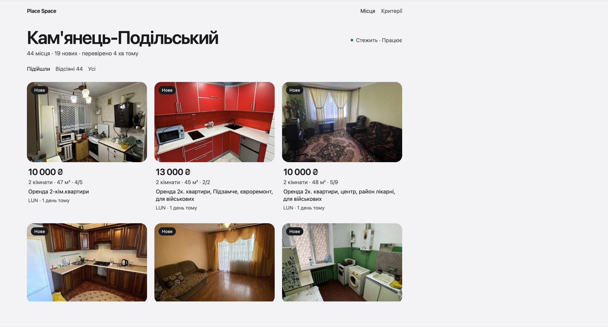
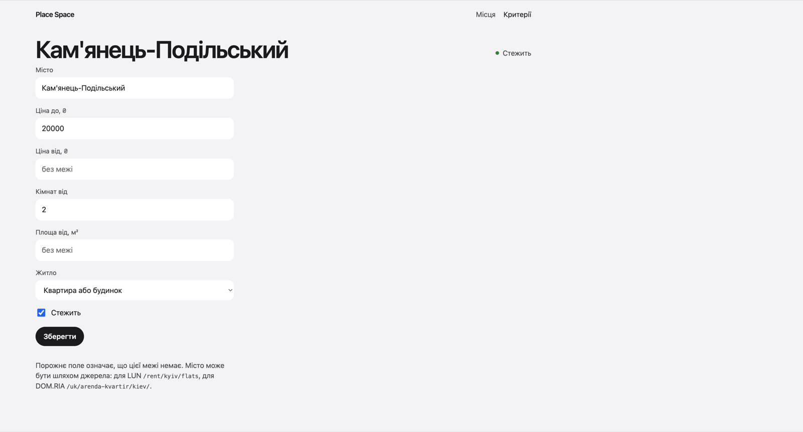

# Place Space

Локальний монітор оренди. Програма сама перечитує [LUN](https://lun.ua), [DOM.RIA](https://dom.ria.com) і [Otodim](https://www.otodim.com.ua), залишає оголошення у ваших межах і позначає ті, що з’явилися за останню добу.

Сайт: [flat.eggs.gd](https://flat.eggs.gd). Його збирає SvelteKit і публікує GitHub Actions на кожен push у `main`, що чіпає `site/`.



Критерії задаються у вікні. Порожнє поле означає, що цієї межі немає. Мітка «Нове» стоїть на оголошенні, яке програма вперше побачила менше ніж добу тому серед тих, що підійшли.




## Запуск

Подвійний клік по зібраній програмі відкриває вікно і починає перевірку. На Windows це `place-space.exe`, на Mac — `Place Space.app` для Apple Silicon. Закриття вікна зупиняє перевірки.

База `place-space.db` і журнал `place-space.log` лежать у каталозі даних користувача:

- Windows: `%AppData%\Place Space`
- Mac: `~/Library/Application Support/Place Space`
- Linux: `~/.config/place-space`

Інший каталог задає змінна `PLACE_SPACE_DATA`, окремий файл бази — `--db`. Версії до 0.0.7 включно тримали базу в папці `data` поруч із програмою, а на Mac поруч із `.app`. Під час першого запуску нова версія копіює її в каталог даних, а стара копія лишається на місці, і її можна видалити.

Посилання «Відкрити оголошення» відкривається у звичайному браузері.

Збірку робить [GitHub Actions](.github/workflows/desktop.yml). Запуск workflow вручну кладе `place-space.exe` і `place-space-macos.zip` у вкладку Actions. Тег на кшталт `v0.1.0` публікує реліз. Mac-програма не підписана, тож перший запуск може вимагати правий клік і «Відкрити». На Windows потрібен WebView2, він уже є у Windows 10 і 11.

З вихідників вікно збирається так:

```bash
cd web && npm install && npm run build
go build -tags ui -o place-space ./cmd/placespace
./place-space
```

Для розробки інтерфейсу API лишається без вікна, а SvelteKit крутиться окремо:

```bash
go run ./cmd/placespace serve
```

```bash
cd web && npm install && npm run dev
```

Сторінка: http://localhost:5173. Поки вона відкрита, дані перечитуються кожні 30 секунд.

Пошук можна створити і з термінала. Команда одразу перевіряє джерела. Через `go run` усі команди, як і `serve`, пишуть у `data/place-space.db` робочого каталогу, а зібрана програма пише в каталог даних:

```bash
go run ./cmd/placespace poll \
  --city "Кам'янець-Подільський" \
  --price-max 20000 \
  --rooms-min 2
```

Пошук можна звузити до районів: `--areas "Дарницький,Осокорки"`. Те саме є у вікні, у списку під містом.

Міста поза вбудованим списком передаються шляхом каталогу: для LUN `/rent/kyiv/flats`, для DOM.RIA `/uk/arenda-kvartir/kiev/`, для Otodim `/uk/rezultaty/orenda/kvartyry/kyiv/kyiv/kyiv/kyiv`. Квартири й будинки разом: `--property apartment,house`.

`placespace run` перевіряє збережені пошуки без HTTP. `placespace status` друкує останній стан.

## Джерела

Окрім каталогів, програма звертається лише до bank.gov.ua по офіційний курс.

Підключені LUN, DOM.RIA і Otodim, платформа житла від OLX Group, яка показує оголошення з OLX. Публічного пошукового API в цих каталогів немає: картки вже лежать у HTML сторінки як JSON, тож адаптер читає їх напряму. Дошки, які не віддають каталог звичайним запитом, не підключені.

## Поведінка

- Інтервал береться з пошуку, типово 10 хвилин. Перша перевірка після запуску відбувається одразу.
- Однакове оголошення з двох різних адрес лишається двома картками. Збіг визначається за джерелом і зовнішнім id, а також за канонічним посиланням.
- Якщо межа вимагає ціну, кімнати чи площу, оголошення без цього поля її не проходить.
- Межі ціни типово задаються в гривнях. Ціни в доларах чи євро порівнюються за курсом НБУ, який оновлюється двічі на добу і зберігається в базі. На картці лишається опублікована ціна. Оголошення у валюті без курсу не проходить межу.
- Зникнення з чергової сторінки пошуку не видаляє картку одразу. Оголошення, якого не було видно три доби до останньої вдалої перевірки джерела, ховається зі стрічки. Після довгої перерви в роботі програми це стається під час першої вдалої перевірки. Видаляється разом з історією лише те, чого джерело не показувало протягом 30 діб перевірок, тож сама перерва нічого не видаляє.
- Райони читаються зі сторінок самих каталогів раз на тиждень, а пошук іде за окремою сторінкою кожного району, тож видно всю пропозицію, а не лише свіжу. Мікрорайони згруповані під районами, а обраний район уже містить свої мікрорайони. Можна обрати до п'яти. Якщо району немає на одному з джерел, це джерело для нього пропускається, а не читається ціле місто. Малі міста каталоги на райони не ділять. Otodim районів поки не підтримує, тож пошук із районами його пропускає.
- LUN і Otodim читаються від найновіших оголошень. У DOM.RIA такого сортування не знайдено, там порядок типовий.
- Якщо джерело відповідає 403 або 429, воно відпочиває 30 хвилин.
- Новий або ввімкнений пошук підхоплюється без перезапуску.
- API приймає запити лише від власної сторінки та з цього комп’ютера.
- За одну перевірку читається щонайбільше 5 сторінок каталогу на кожен тип житла, а в Otodim 2, бо його сторінки значно важчі.
